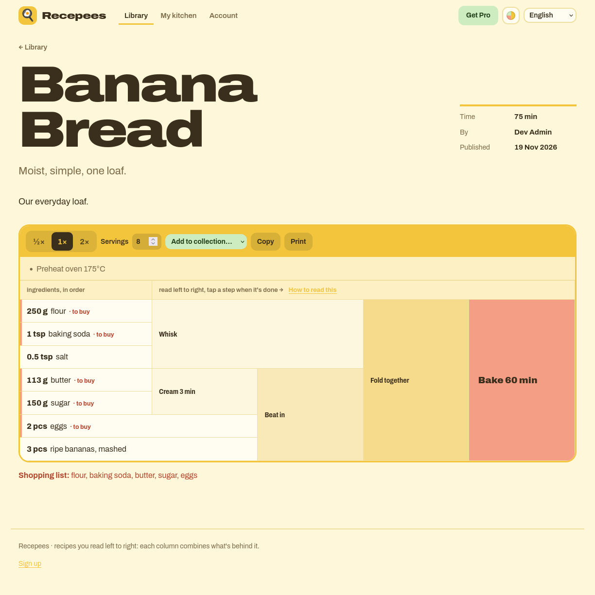
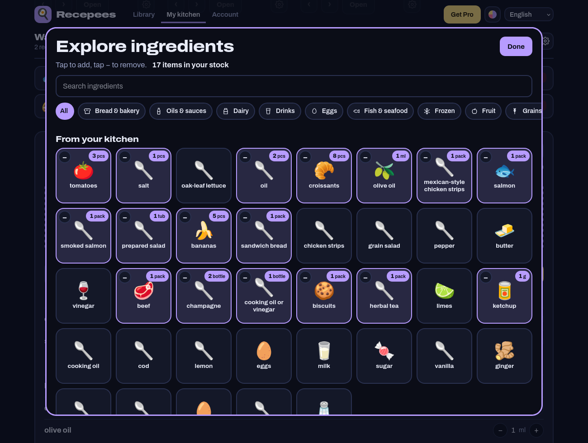
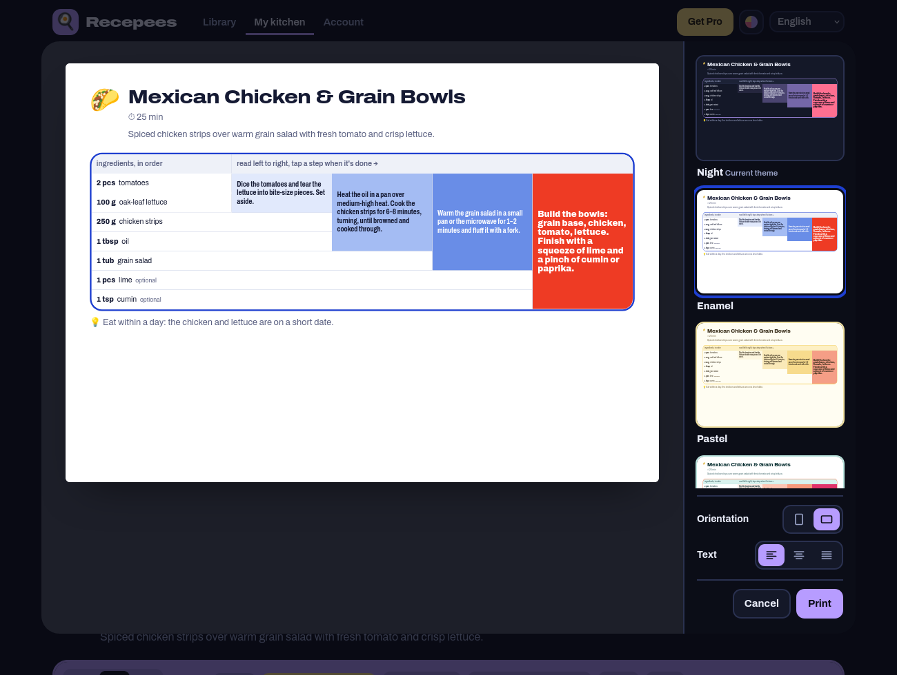
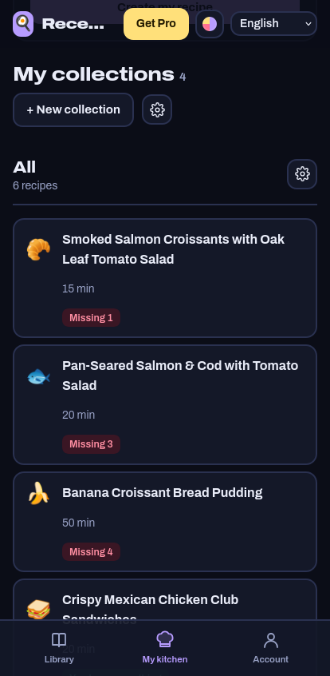

# Recepees 🍳

Recipes you can actually cook from. Ingredients run down the left in the order you use them, each step spans exactly what it combines, and everything converges into the dish. Built as a **Ghost** theme with a small companion API: members get **My kitchen** (collections, stock, today's pick), and the AI turns any link, pasted text or cookbook photo into a recipe, metered per plan.

No npm dependencies anywhere: Node 24 built-ins, plain browser JS, Ghost and Tesseract.

<!-- SCREENSHOTS: drop PNGs into docs/screenshots/ with these names (see docs/screenshots/README.md). -->
| | |
|---|---|
| **Library** | **A recipe** |
|  |  |
| | |
| **My kitchen**: today's pick, create a recipe | **Collections** as 3D stacks |
|  |  |
| **Ingredient explorer** | **Print** in every style |
| | |
|  |  |
| **Colour themes**: Enamel, Pastel, Summer, Night | **Admin center** |
| | |
|  |  |
| **On a phone** | **How to read a recipe**: the animated explainer |
|  |  |

## Features
**For members**
- **Recipes as convergence tables**: scale servings, tick off steps, see what's missing from your stock, translate, print.
- **Create a recipe** from a link, pasted text or a cookbook photo (OCR first, AI vision as fallback). **Extract text only** is free.
- **Today's pick**: one recipe a day from your stock, free; claim a copy into your kitchen.
- **Collections**: three pre-filled starters plus the built-in **All**; 3D stacks you can flip through, or grid / list layouts; covers, hiding, ordering; an overview to manage them all.
- **Stock**: add by photo, by hand, or tap tiles in the **ingredient explorer**; shelves by category with icons; **Sort my stock with AI** (limited per plan).
- **Trash**: deleted collections, recipes and ingredients are restorable (`/my/trash/`, linked at the bottom of the kitchen); every delete has Undo.
- **How to read a recipe** (`/how-to-read/`): an animated, captioned, narrated line-art explainer with a full player. Storyboard and art direction: [`docs/how-to-read/STORYBOARD.md`](docs/how-to-read/STORYBOARD.md).
- **6 languages** (English, Español, Français, Português, Italiano, Deutsch) and **4 colour themes** (Enamel, Pastel, Summer, Night), both remembered per visitor and per member.

**For the site owner**
- Accounts, plans and payments are **native Ghost** (Portal + Stripe).
- **Admin center** (`/api/admin`): analytics, per-member usage editing and bonus AI uses, stock tags with SVG icons, AI tagging mode.
- **Ghost design settings**: kitchen name and default colour theme.

## How it fits together
```
browser ──► api (server.js :3000) ──► /api/*  kitchen, stock, OCR, AI, usage, admin center ──► SQLite (data/recepees.db)
                                 │                                    └──► ocr (Tesseract :8884, internal only)
                                 └──► else    Ghost (theme, members, Portal, Stripe, /ghost admin)
```
One origin for everything, so the Ghost member cookie reaches the API, which asks Ghost who is signed in (cached for 30s). There's no second login system.

| Service | What | Image |
|---|---|---|
| `api` | gateway + API, the only public port | `Dockerfile` (node:24-alpine) |
| `ghost` | site, members, subscriptions, admin | `Dockerfile.ghost` in prod (theme baked in), `ghost:6-alpine` + mounted theme in dev |
| `ocr` | Tesseract 5 over HTTP | `ocr/Dockerfile` |
| `db` | MySQL 8.4, prod only (dev uses sqlite) | `mysql:8.4` |
| `mailpit` | catches sign-in emails, dev only | `axllent/mailpit` |

| Path | |
|---|---|
| `server.js` | gateway + API |
| `admin.html` | admin center |
| `theme/` | the Ghost theme (`*.hbs`, `assets/css/screen.css`, `assets/js/*.js`) |
| `ghost/routes.yaml` | `/my/` (kitchen) and `/my/trash/` |
| `theme/page-how-to-read.hbs`, `theme/assets/how-to-read/`, `theme/partials/how-to-read-art.hbs` | the explainer page: template, storyboard + voice-over, line art |
| `ocr/` | OCR microservice |
| `default-tags.json`, `seed-recipes.json` | built-in stock tags and starter recipes |

## Develop
```sh
make env        # creates .env: set ANTHROPIC_API_KEY, ports, limits
make up         # builds + starts, prints the URLs
```
- Site: `http://localhost:$PORT`. Ghost admin is at `/ghost`; your first visit creates the owner account.
- **Settings → Design → activate "recepees"** (once).
- Sign-in emails land in mailpit at `http://localhost:$MAIL_UI_PORT`.
- `theme/` is mounted live (no asset caching in dev) and `server.js` restarts on save. Run `make restart` after editing `ghost/routes.yaml` or `theme/package.json`.

| | |
|---|---|
| `make dev` / `make up` / `make down` | run in foreground / background / stop |
| `make logs [s=ghost]` | follow logs |
| `make check` | validate the theme with gscan |
| `make zip` | `recepees-theme.zip` for uploading to any Ghost site |
| `make ocr-test img=page.jpg` | OCR an image through the running stack |
| `make build` / `make prod` | build / run the production stack locally |
| `make reset` | **delete** all dev data and start fresh (asks first) |

`bun run dev` also works; it calls `make dev`.

## Settings
Docker Compose reads `.env` for both stacks; in Coolify set the same names as environment variables.

| Variable | Default | |
|---|---|---|
| `ANTHROPIC_API_KEY` | (empty) | turns on the AI features |
| `CLAUDE_MODEL` | `claude-sonnet-5-5` | |
| `FREE_AI_PER_MONTH` / `PAID_AI_PER_MONTH` | `5` / `200` | AI uses per member per month |
| `SORT_FREE_PER_MONTH` / `SORT_PAID_PER_MONTH` | `3` / `30` | AI stock sorts per month (also count toward the allowance) |
| `API_RATE_PER_MIN` | `120` | per-IP limit on `/api/*` |
| `ADMIN_TOKEN` | `dev` | unlocks `/api/admin`. **Use a long random value in production.** |
| `OCR_LANGS` | `eng+fra` | Tesseract languages (installed: eng fra deu spa ita por nld; add more in `ocr/Dockerfile`) |
| `PORT` / `MAIL_UI_PORT` | `3000` / `8026` | dev host ports |
| `GHOST_VERSION` | `6` | dev Ghost image tag |
| `PUBLIC_URL` | (empty) | production: `https://your.domain` |
| `MYSQL_PASSWORD` | (empty) | production |
| `MAIL_FROM`, `SMTP_HOST`, `SMTP_PORT`, `SMTP_SECURE`, `SMTP_USER`, `SMTP_PASS` | mailpit in dev | production needs real SMTP for member sign-in |

**In Ghost admin → Settings → Design:** *Kitchen name* (default "My kitchen", translated; a custom name shows as typed) and *Palette* (the default colour theme).
**In the admin center:** stock tags + icons, AI tagging mode (off / assign / assign and create), member usage and bonus AI uses.

## Publishing a recipe
Write a normal Ghost post and add an **HTML card** containing:
```html
<script type="application/recipe+json">{"title":"…","servings":4,"steps":[{"text":"Whisk","after":[],"uses":[{"name":"flour","amount":250,"unit":"g"}]}]}</script>
```
`after` lists the earlier steps whose result this step uses (defaults to the previous step); steps with nothing to combine, like "preheat oven", appear above the table. Staff signed in to Ghost get a **Copy for Ghost** button on any recipe in their kitchen that produces this snippet. Set post access to *Paid members* for Pro-only recipes; add `"lang": "fr"` (etc.) if a recipe isn't in the site's language.

## Languages
- **UI text** lives in `theme/assets/js/i18n.js`; keys are the English text, so anything missing falls back to English. In templates add `data-t` to an element; in JS call `t('Text', { vars })`.
- **AI output follows the visitor's language**; **Translate → \<language\>** converts any recipe (one AI use).
- **To add a language:** add it to `LANGS` and `D` in `i18n.js`, `LANG_NAMES` in `server.js`, and a name column in `theme/assets/js/ingredients.js`.
- Ghost's own Portal popup and member emails follow the site's publication language (Ghost → Settings → General).

## API
| | |
|---|---|
| `GET /api/me`, `PUT /api/prefs` | member, plan, usage, preferences (colour theme) |
| `GET/PUT /api/stock` | stock (items removed by a PUT go to the trash) |
| `POST /api/stock/sort` | AI files untagged stock under tags (metered, per-plan cap) |
| `GET /api/ingredients/history` | every ingredient the member's kitchen has seen |
| `GET /api/tags` | stock tags + the AI tagging mode |
| `GET/POST /api/recipes`, `DELETE /api/recipes/:id` | the member's recipes |
| `GET/POST /api/collections`, `PATCH/DELETE /api/collections/:id` | collections (`all` is built in) |
| `GET /api/daily`, `POST /api/daily/claim` | today's pick, claim a copy |
| `GET/DELETE /api/trash`, `POST /api/trash/:id/restore`, `DELETE /api/trash/:id` | trash |
| `POST /api/ocr` `{image}` | text from a photo (free) |
| `POST /api/convert` `{url\|text\|image}` | create a recipe (AI, metered) |
| `POST /api/generate` `{ingredients, notes}` | recipe from stock (AI, metered) |
| `POST /api/recognize` `{image}` | ingredients from a photo (AI, metered) |
| `POST /api/translate` `{recipe, lang}` | translate a recipe (AI, metered) |
| `/api/admin`, `/api/admin/*` | admin center + its API (Bearer `ADMIN_TOKEN`) |
| `GET /api/health` | healthcheck |

Images are sent as `data:image/...;base64,` URLs. AI endpoints take an optional `lang` (`en es fr pt it de`). Everything except health and admin needs a signed-in member.

## Security
- **Usage limits** are single SQL statements, so parallel requests can't overshoot; a failed AI call gives the use back.
- **Rate limiting** per IP on `/api/*`, using the hop your own proxy (Traefik) adds, so clients can't spoof it.
- **Pasted links:** public http(s) only, re-checked on every redirect, 15s timeouts.
- **Headers:** `nosniff`, `SAMEORIGIN`, referrer policy everywhere; HSTS behind https; strict CSP on API and admin responses (Ghost pages skip it because Portal and Stripe load third-party scripts).
- **SVG icons** render as CSS masks (they can't run code), and the server rejects scripts, event handlers and links in them.
- **Containers:** OCR and Ghost are internal only; api and ocr run as non-root.

## Deploy (GitHub → Coolify)
1. Push this repo to GitHub.
2. In Coolify: **New resource → Docker Compose**, pick the repo, compose file `docker-compose.prod.yml`.
3. Give the **api** service your domain (container port 3000). Nothing else needs a public port.
4. Environment variables: `PUBLIC_URL` (the same domain, with `https://`), `MYSQL_PASSWORD`, `ADMIN_TOKEN` (long and random), `ANTHROPIC_API_KEY`, `SMTP_HOST` / `SMTP_PORT` / `SMTP_USER` / `SMTP_PASS` / `MAIL_FROM`; optionally the limits above.
5. Deploy, open `/ghost` to create the owner account, then **Settings → Design → activate "recepees"** once. Connect Stripe under **Settings → Membership** for paid plans.
6. Create a page with the slug `how-to-read` for the explainer (title and intro are yours; the player is built in).

`Dockerfile.ghost` bakes the theme and `routes.yaml` into the Ghost image and re-copies them on every boot, so each redeploy ships theme changes. Data lives in the `api-data` (SQLite), `ghost-content` and `db` volumes: back those up.
